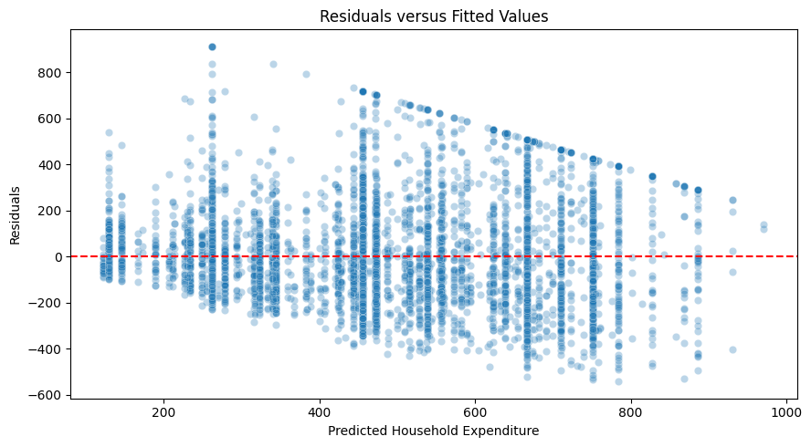
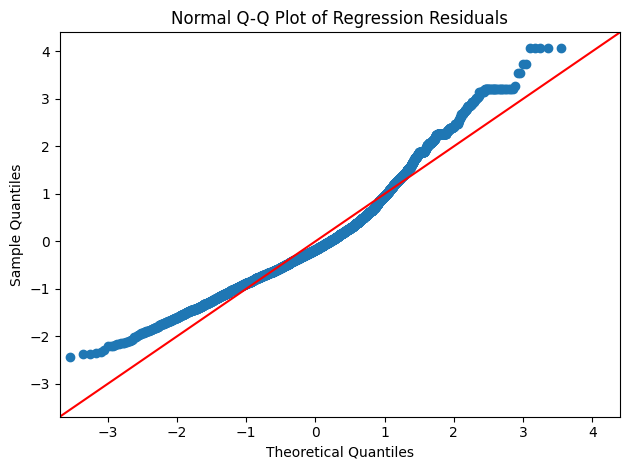
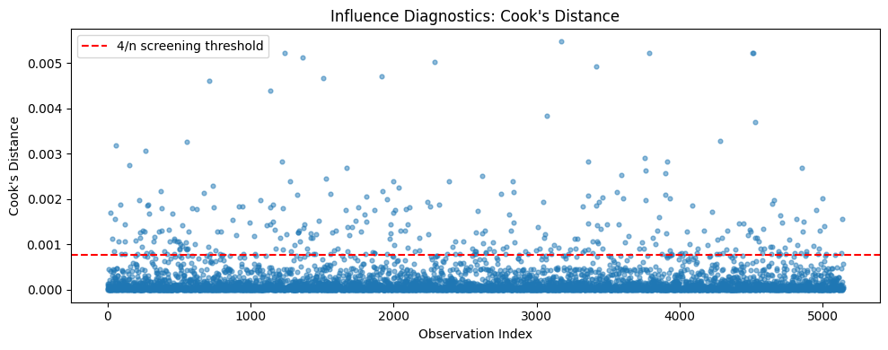
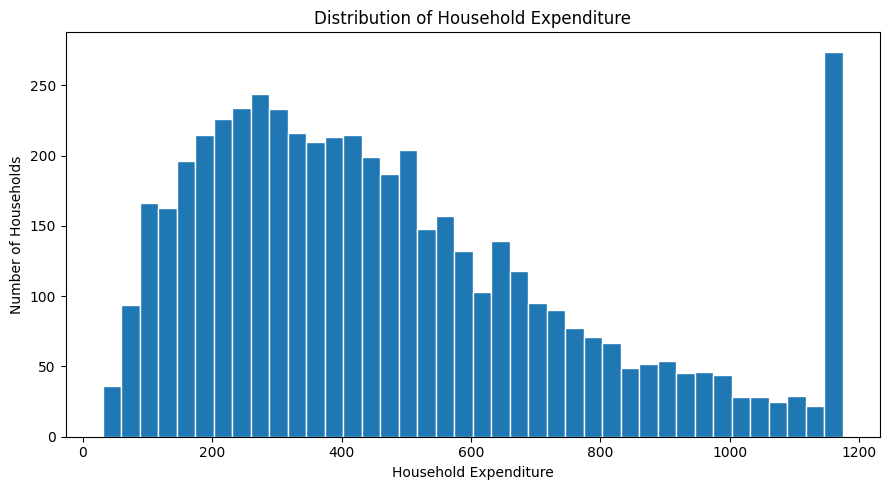
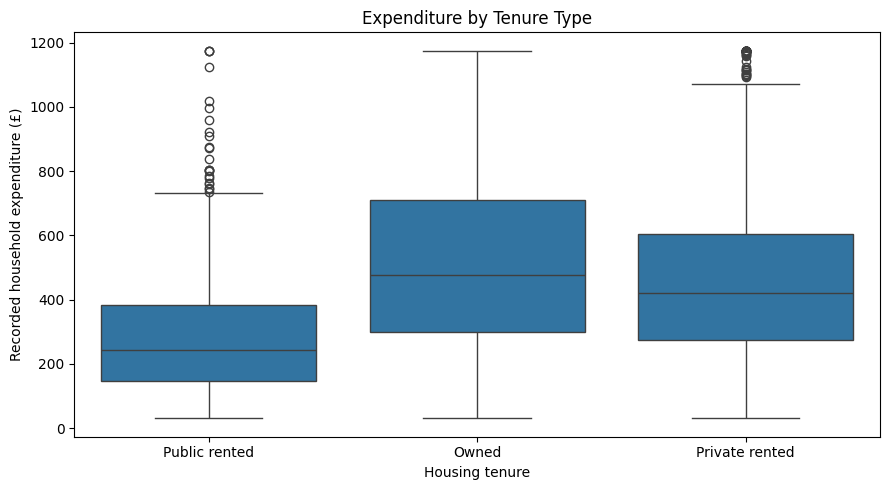

# UK Household Expenditure Analysis

**Data Analytics Portfolio Project | Mayerfeld Consulting Data Analytics Practicum (2026)**

A collaborative statistical analysis of UK household expenditure using Python, exploratory data analysis, multiple linear regression, hypothesis testing, and regression diagnostics.

## 1. Project Overview

This project investigates how household expenditure is associated with occupational class, housing tenure, number of adults, and number of children.

The analysis uses a teaching extract from the 2013 UK Living Costs and Food Survey (LCF), containing 5,144 household observations.

The project was completed collaboratively by Group 3 during the Mayerfeld Consulting Data Analytics Practicum.

## 2. Tools and Technologies

- **Programming:** Python
- **Data analysis:** pandas, NumPy
- **Statistical modelling:** statsmodels
- **Visualisation:** Matplotlib
- **Development environment:** Jupyter Notebook
- **Version control:** Git and GitHub

## 3. Research Question

Is there a relationship between occupational class, housing tenure, number of adults, number of children and household expenditure?

## 4. Project Objectives

1. Explore household expenditure patterns.
2. Prepare and validate the supplied dataset.
3. Examine differences across household characteristics.
4. Estimate adjusted associations using multiple linear regression.
5. Evaluate statistical significance.
6. Assess regression assumptions and model limitations.
7. Communicate findings through visualisations and a collaborative report.

## 5. Dataset

**Source:** 2013 UK Living Costs and Food Survey (LCF), teaching extract.

- Household observations: 5,144
- Variables in the extract: 19
- File format: Stata (.dta)
- Dependent variable: Household expenditure
- Independent variables: Occupational class, housing tenure, adult count and child count

The original survey dataset is not redistributed in this repository.

## 6. Analytical Methodology

The analysis followed these stages:

1. Data import and inspection.
2. Data preparation and categorical variable conversion.
3. Exploratory data analysis.
4. Ordinary least squares (OLS) regression.
5. HC3 heteroscedasticity-robust statistical inference.
6. Hypothesis testing and regression diagnostics.
7. Sensitivity analysis and interpretation.

Diagnostic procedures included the Breusch-Pagan test, residual analysis, Q-Q plots, variance inflation factors (VIF), and Cook's distance.

## 7. Key Findings

| Indicator | Result |
|---|---|
| Households analysed | 5,144 |
| Mean recorded expenditure | £479.76 |
| Model R-squared | 0.4124 |
| Variation explained | 41.24% |
| Overall HC3 robust F-statistic | 392.22 |
| Overall model significance | p < 0.001 |

All four household characteristics were statistically significant in separate HC3 robust joint tests.

The findings indicate adjusted associations between household expenditure and socioeconomic or household composition characteristics.

**Important:** These results describe associations within the teaching dataset and do not establish causal relationships.

## 8. Data Visualisations

### Residuals vs Fitted Values



### Q-Q Plot



### Cook's Distance



### Household Expenditure Distribution



### Expenditure by Housing Tenure



## 9. Repository Structure

```text
uk-household-expenditure-analysis/
|
|-- Notebooks/
|   |-- 01_uk_household_expenditure_analysis.ipynb
|
|-- figures/
|   |-- 01_residuals_vs_fitted.png
|   |-- 02_qq_plot_residuals.png
|   |-- 03_cooks_distance.png
|   |-- 04_household_expenditure_distribution.png
|   |-- 05_expenditure_by_housing_tenure.png
|
|-- reports/
|   |-- UK_Household_Expenditure_Case_Study_Group_3.pdf
|
|-- documentation/
|   |-- uk_household_expenditure_documentation.md
|
|-- README.md
```

## 10. Project Documentation

For detailed information about data preparation, regression methodology, diagnostic tests, results and limitations, see:

[Technical Documentation](documentation/uk_household_expenditure_documentation.md)

The complete collaborative case study is available in the `reports/` folder.

## 11. Limitations

- Observational data cannot establish causation.
- Household expenditure is top-coded.
- The primary regression is unweighted.
- Residual heteroscedasticity and non-normality were identified.
- Potential omitted variables and survey sampling effects remain limitations.

## 12. Conclusion

The project demonstrates practical application of Python, statistical analysis, multiple linear regression, robust hypothesis testing, data visualisation and analytical reporting.

The analysis identified statistically significant relationships between household expenditure and the four selected household characteristics, with the fitted model explaining approximately 41.24% of observed expenditure variation.

## 13. Project Team

**Mayerfeld Consulting Data Analytics Practicum — Group 3**

Bugra, Ziad, Amal, Augustine, Nabpreet and Sharifah.

## 14. Author and Portfolio

**Isabirye Augustine**

GitHub: [isabiryeaugustine](https://github.com/isabiryeaugustine)

*This repository presents a collaborative educational case study as part of a personal data analytics portfolio.*
