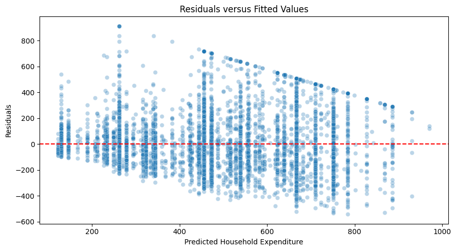
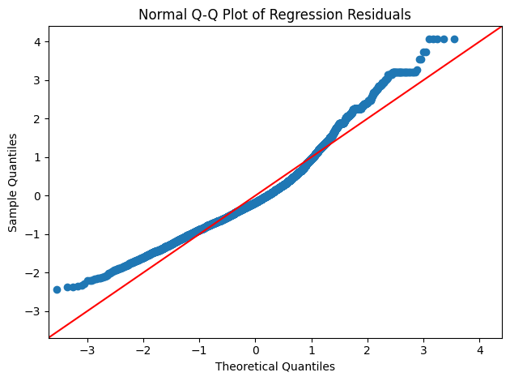
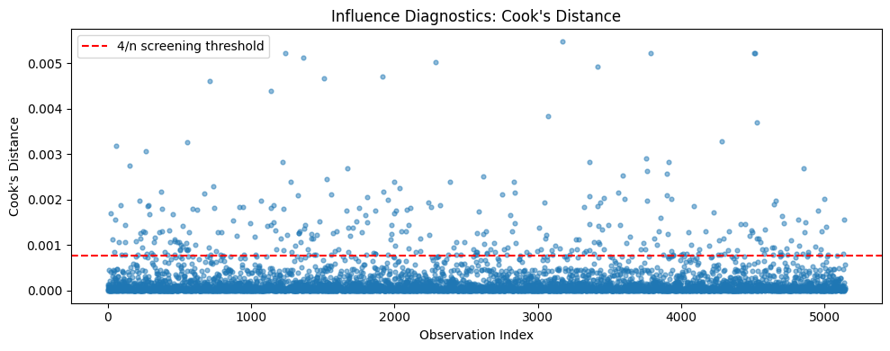
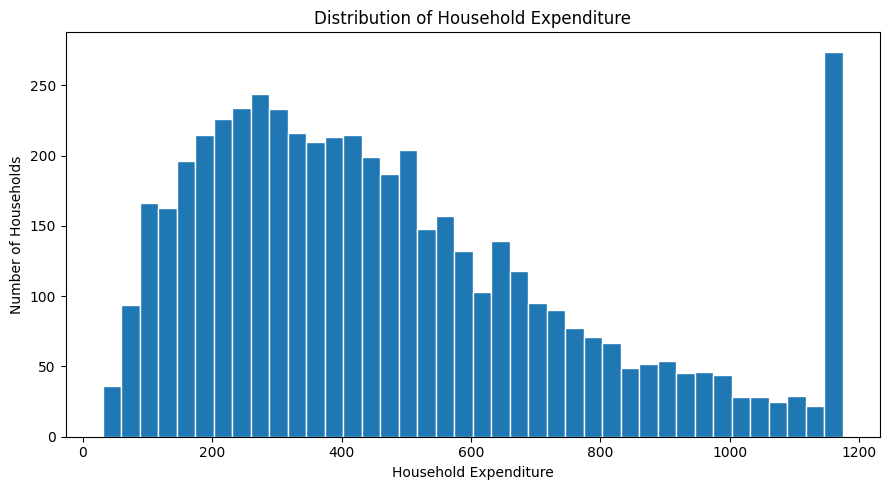
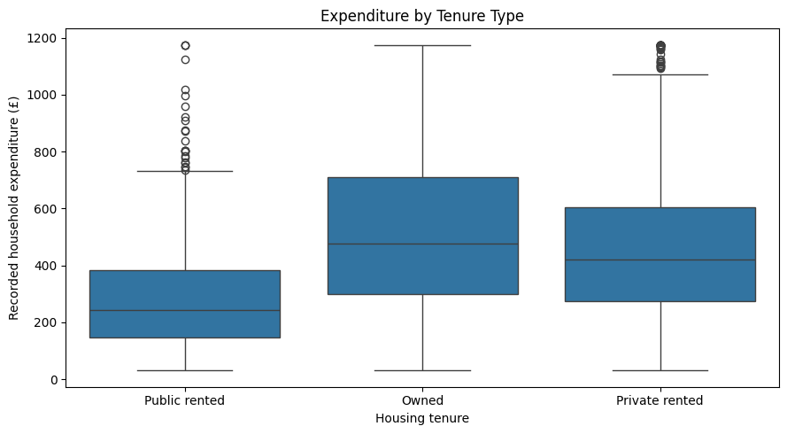

# UK Household Expenditure Analysis — Technical Documentation

**Project:** UK Household Expenditure Analysis  
**Program:** Mayerfeld Consulting Data Analytics Practicum (2026)  
**Project type:** Collaborative Group 3 Case Study  
**Dataset:** 2013 UK Living Costs and Food Survey (LCF) — Teaching Extract  
**Tools:** Python, pandas, NumPy, statsmodels, Matplotlib, Jupyter Notebook, Git and GitHub

---

## 1. Project Overview

This project investigates the relationship between household characteristics and recorded household expenditure using a teaching extract from the 2013 UK Living Costs and Food Survey.

The analysis examines four explanatory factors:

1. Occupational class
2. Housing tenure
3. Number of adults
4. Number of children

Multiple linear regression was used to estimate adjusted associations between these factors and household expenditure.

The project was completed collaboratively by Group 3 during the Mayerfeld Consulting Data Analytics Practicum.

## 2. Research Question

Is there a relationship between occupational class, housing tenure, number of adults, number of children and household expenditure?

The objective was to identify statistically significant associations while accounting for the other explanatory variables included in the model.

## 3. Dataset Description

**Source:** 2013 Living Costs and Food Survey, UK Data Service Study 7702  
**File format:** Stata (.dta)  
**Observations:** 5,144 households  
**Variables in teaching extract:** 19

The dataset was imported into Python using pandas.

### Variables Used

| Variable | Description | Analytical role |
|---|---|---|
| expenditure | Recorded household expenditure | Dependent variable |
| A094r | Occupational class | Independent variable |
| A121r | Housing tenure | Independent variable |
| G018r | Grouped number of adults | Independent variable |
| G019r | Grouped number of children | Independent variable |

The four independent variables were treated as categorical factors.

The five variables selected for regression contained no missing values, allowing all 5,144 observations to be retained.

## 4. Data Preparation

The following steps were performed:

1. Imported the Stata dataset directly into Python.
2. Inspected the dataset structure and variable labels.
3. Selected the expenditure outcome and four explanatory variables.
4. Checked missing values in the selected fields.
5. Converted explanatory variables to categorical data types.
6. Examined expenditure distributions and category frequencies.
7. Prepared the dataset for regression modelling.

The expenditure variable was top-coded. A total of 256 households, approximately 4.98% of the sample, had the recorded maximum expenditure of £1,175.

This restriction was considered when interpreting the results.

## 5. Exploratory Data Analysis

Exploratory analysis was conducted to understand the distribution of household expenditure and differences across household categories.

The visual analysis included:

- Household expenditure distribution.
- Expenditure comparisons by housing tenure.
- Residuals-versus-fitted-values plot.
- Q–Q plot of regression residuals.
- Cook's distance plot.

### Project Figures

## 6. Statistical Methodology

### Multiple Linear Regression

Ordinary least squares (OLS) regression was used to estimate the relationship between household expenditure and the four household characteristics.

The model included categorical indicators for:

- Occupational class
- Housing tenure
- Grouped adult count
- Grouped child count

The primary model was additive, meaning that each factor's association was estimated while adjusting for the other factors.

### Robust Statistical Inference

HC3 heteroscedasticity-robust standard errors were used because diagnostic testing indicated non-constant residual variance.

The analysis used an unweighted model. Consequently, the estimates should not be interpreted as fully survey-design-adjusted population results.

## 7. Regression Diagnostics

Several diagnostic procedures were performed to assess model assumptions and reliability.

### 7.1 Heteroscedasticity

Residuals were examined using a residuals-versus-fitted-values plot and the Breusch–Pagan test.

The Breusch–Pagan test indicated statistically significant heteroscedasticity (p approximately 5.59 × 10^-52).

HC3 robust standard errors were therefore used for inference.

### 7.2 Residual Normality

A Q–Q plot and normality diagnostics indicated departures from a normal residual distribution.

Robust large-sample inference was used, while acknowledging that robust standard errors do not correct every possible model limitation.

### 7.3 Multicollinearity

Variance inflation factors (VIFs) were calculated.

The reported VIF range was approximately 1.082 to 1.827, indicating no evidence of problematic multicollinearity among the model's indicator variables.

### 7.4 Influential Observations

Cook's distance was calculated to identify potentially influential households.

Using the screening threshold of 4/n:

- 324 households (6.30%) were flagged.
- Maximum Cook's distance was approximately 0.00548.

A sensitivity analysis excluding flagged observations found that coefficient directions remained unchanged, although some magnitudes differed.

All observations were retained in the primary model.

### 7.5 Model Specification

An interaction between adult count and child count was examined.

The HC3 robust joint test was not statistically significant (F = 0.821, p = 0.554).

The original additive model was therefore retained.

## 8. Hypothesis Testing

**Null hypothesis (H0):** The four household characteristics are not jointly associated with recorded household expenditure.

**Alternative hypothesis (H1):** At least one regression coefficient representing the household characteristics differs from zero.

The overall model was evaluated at a 5% significance level using HC3 robust inference.

## 9. Key Findings

| Metric | Result |
|---|---|
| Households analysed | 5,144 |
| Mean recorded expenditure | £479.76 |
| Model R-squared | 0.4124 |
| Explained variation | 41.24% |
| HC3 robust overall F-statistic | 392.22 |
| Overall model significance | p < 0.001 |

The model explained approximately 41.24% of the observed variation in recorded household expenditure.

Occupational class, housing tenure, adult count and child count were statistically significant in separate HC3 robust joint tests.

Adjusted comparisons indicated that:

- Larger adult groups were associated with higher recorded expenditure.
- Households with children generally had higher adjusted expenditure than households without children.
- Private renting and owner occupation were associated with higher expenditure than public renting.
- Nonreference occupational classes had lower adjusted estimates than the higher managerial, administrative and professional reference group.

These findings represent statistical associations, not causal relationships.

## 10. Limitations

The analysis has several important limitations:

1. **Observational data:** The findings cannot establish causation.
2. **Top-coded expenditure:** The upper limit restricts observed variation among higher-expenditure households.
3. **Unweighted regression:** The primary model does not incorporate the full survey sampling design.
4. **Residual heteroscedasticity:** Robust standard errors address inference but do not remove all modelling concerns.
5. **Residual non-normality:** Diagnostic plots showed departures from normality.
6. **Potential omitted variables:** Other socioeconomic factors may influence expenditure.
7. **Survey independence:** Possible clustering could not be fully assessed from the teaching extract.

## 11. Reproducibility

The repository contains the materials used to present the project:

- `Notebooks/` — Python analysis notebook.
- `figures/` — Exploratory and regression diagnostic plots.
- `reports/` — Collaborative Group 3 case study report.
- `documentation/` — Technical methodology and findings.
- `README.md` — Project overview.

The original survey dataset is not included in the public repository.

Reproducing the analysis requires appropriate access to the teaching dataset and the Python packages used in the notebook.

## 12. Conclusion

The analysis found statistically significant adjusted associations between household expenditure and occupational class, housing tenure, adult count and child count.

The model explained 41.24% of observed expenditure variation in the supplied teaching sample.

Regression diagnostics identified heteroscedasticity, non-normal residuals and potentially influential observations. HC3 robust inference and sensitivity checks were used to support interpretation.

The project demonstrates practical experience in data preparation, exploratory analysis, multiple linear regression, statistical hypothesis testing, model diagnostics and collaborative analytical reporting.

## 13. References

- UK Data Service. Living Costs and Food Survey, 2013, Study 7702.
- Supplied LCF teaching extract and accompanying course documentation.
- Mayerfeld Consulting Data Analytics Practicum (2026), Group 3 case study report.
